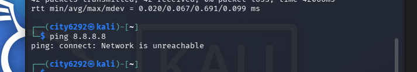
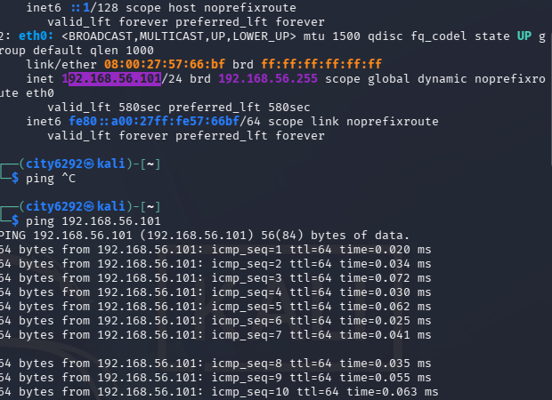
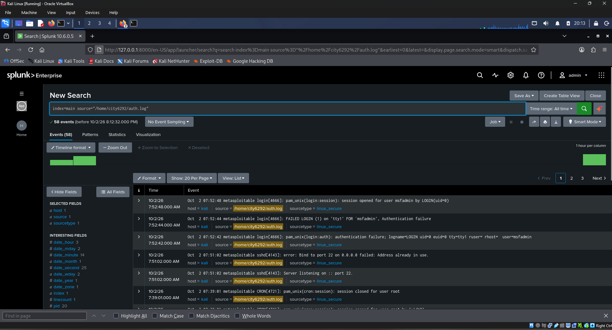

# Project 1: SSH Brute-Force Detection in Splunk

## Objective
Simulate an SSH brute-force attack against a vulnerable target and detect the attack using Splunk's log analysis capabilities.

## Environment

| Component | Details |
|-----------|---------|
| Hypervisor | VirtualBox 7.x |
| Attacker | Kali Linux — `192.168.56.101` |
| Victim | Metasploitable2 — `192.168.56.102` |
| SIEM | Splunk Enterprise (installed on Kali) |
| Network | Isolated Host-Only Adapter (`vboxnet0`, 192.168.56.1/24) |

## Methodology

### 1. Lab Setup & Isolation Verification
Built an isolated Host-Only network in VirtualBox with Kali Linux (attacker) and Metasploitable2 (victim). Verified network isolation by confirming Kali had the correct IP and could not reach the internet.




### 2. Attack Simulation
Created a brute-force script from Kali to attempt multiple passwords against `msfadmin@192.168.56.102`. 

*(Note: Because Metasploitable2 uses an ancient version of OpenSSH, modern tools like Hydra failed. I had to use `sshpass` with legacy algorithm flags to force the connection).*

### 3. Log Ingestion
Transferred `/var/log/auth.log` from Metasploitable2 to Kali. Uploaded to Splunk via **Settings → Data Inputs → Files & Directories**. Splunk successfully parsed the logs using the `linux_secure` source type.



### 4. Detection Query
Ran the following SPL search in Splunk to identify the brute-force pattern:

```splunk
index=main source="/home/city6292/auth.log" "Failed password"
| rex "Failed password for (?<user>\S+) from (?<src_ip>\S+)"
| stats count by src_ip, user
| where count > 3

Findings
Source IP	Target User	Failed Attempts
192.168.56.101	msfadmin	12
The detection successfully identified 12 failed SSH login attempts from the attacker machine (192.168.56.101) against the msfadmin account, occurring within a short time window.

https://./screenshot/detection-result.png

Troubleshooting & Lessons Learned
Legacy SSH Compatibility: Metasploitable2 only supports deprecated algorithms (diffie-hellman-group1-sha1, ssh-rsa). Modern Kali rejects these. I had to explicitly force the older algorithms in my SSH commands to simulate the attack.

No APT Sources: Kali was unable to install sshpass initially because the isolated VM had no internet access or APT sources configured. I had to temporarily switch the network adapter to NAT, update the packages, and switch back to Host-Only to maintain isolation.

https://./screenshot/apt-error.png
